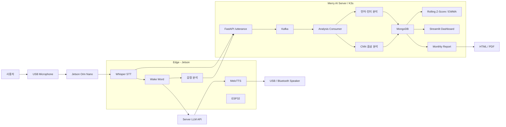

# 🧠 Merry AI v1.0
### 음성 대화를 기반으로 인지·언어·감정 변화를 분석하는 AI 돌봄 시스템

> Merry AI는 사용자의 일상 대화를 음성으로 수집하고, STT·언어 분석·감정 분석·CNN 기반 음성 분석·장기 추세 분석을 통해 인지 변화 징후를 관찰할 수 있도록 설계한 AI 기반 대화형 시스템입니다.

---

## 💡 1. 프로젝트 개요

### 1-1. 프로젝트 소개

- **프로젝트명** : Merry AI
- **프로젝트 정의** : 음성 기반 자연스러운 대화를 통해 사용자의 언어·감정·음성 특징을 수집하고, 장기적인 변화 추이를 분석하여 인지 저하 가능성을 조기에 관찰할 수 있도록 지원하는 AI 시스템
- **주요 실행 환경**
  - Edge Device : NVIDIA Jetson Orin Nano
  - Server : Linux + Docker + Kubernetes(K3s)
  - Dashboard : Streamlit
  - Report : FastAPI + Jinja2
  - Data Pipeline : FastAPI → Kafka → Analysis Consumer → MongoDB

### 1-2. 개발 배경 및 필요성

인지 저하는 짧은 검사 한 번으로 판단하기보다 일상생활에서 나타나는 작은 변화를 장기간 관찰하는 것이 중요합니다.

특히 다음과 같은 변화는 대화 과정에서도 나타날 수 있습니다.

- 특정 대상을 정확히 표현하지 못하고 지시대명사를 자주 사용하는 현상
- 사용하는 어휘의 다양성 감소
- 동일하거나 유사한 단어·표현의 반복 증가
- 문장 구조 단순화
- 감정 상태의 장기적인 변화
- 음성 특징 기반 인지 위험 신호

Merry AI는 별도의 복잡한 검사 과정 대신 사용자가 AI와 자연스럽게 대화하는 과정에서 데이터를 수집하고 분석하도록 설계했습니다.

이를 통해 사용자의 일상적인 발화를 기반으로 **언어·인지·감정·음성 특징의 장기 변화 추세**를 확인할 수 있습니다.

### 1-3. 프로젝트 특장점

- **일상 대화 기반 분석** : 별도의 설문이나 검사 과정이 아닌 자연스러운 음성 대화 데이터 활용
- **Edge + Server 분산 구조** : Jetson에서 사용자 상호작용을 처리하고 서버에서 데이터 수집·장기 분석·LLM 응답·시각화를 수행
- **다중 분석 지표** : 지시대명사, 어휘 다양성, 반복 발화, 문장 복잡도, 감정, CNN 음성 분석
- **장기 추세 기반 이상 변화 탐지** : Rolling Z-Score, EWMA 기반 위험도 추적
- **실시간 데이터 파이프라인** : FastAPI → Kafka → Consumer → MongoDB
- **시각화 및 월간 리포트** : Streamlit Dashboard, HTML 월간 리포트, PDF 다운로드
- **음성 인터페이스** : Wake Word, Whisper STT, LLM, MeloTTS 기반 음성 대화

### 1-4. 주요 기능

#### 🎙️ 음성 대화

사용자가 `"메리야"`라고 호출하면 Merry AI가 활성화되어 음성 대화를 시작합니다.

```text
사용자 음성
   ↓
USB Microphone
   ↓
Whisper STT
   ↓
Wake Word / 사용자 명령 분석
   ↓
LLM
   ↓
MeloTTS
   ↓
USB / Bluetooth Speaker
```

#### 🧠 언어·인지 분석

| 분석 항목 | 설명 |
|---|---|
| 지시대명사 분석 | 이것, 저것 등 지시 표현 사용 변화 |
| 어휘 다양성 | 발화 내 사용 어휘의 다양성 분석 |
| 반복 단어 분석 | 반복되는 단어 및 표현 비율 분석 |
| 문장 복잡도 | 문장 구조의 복잡도 변화 분석 |
| Rolling Z-Score | 개인 기준선 대비 변화량 분석 |
| EWMA | 최근 변화에 가중치를 부여한 장기 추세 분석 |

#### 😊 감정 분석

발화 텍스트에서 다음 5개 감정을 분석합니다.

- 기쁨
- 평온
- 두려움
- 슬픔
- 분노

감정 분석 결과는 발화 단위 이벤트와 함께 MongoDB에 저장되며 대시보드 및 월간 리포트에서 확인할 수 있습니다.

#### 🔊 CNN 음성 분석

사용자의 음성 파일을 CNN 모델로 분석하여 음성 기반 인지 상태 특징을 추출합니다.

현재 대시보드에서는 다음 결과를 표시합니다.

- CNN 판단 결과
- Normal 가능성
- MCI 가능성

#### 📊 분석 대시보드

Streamlit 기반 Dashboard에서 다음 정보를 확인할 수 있습니다.

- 사용자별 분석 결과
- 조회 기간 필터
- STT 발화 내용
- CNN 음성 분석
- 언어·인지 분석
- 감정 분석
- Rolling Z-Score / EWMA
- 일별 추세 차트
- 발화 단위 이벤트 테이블
- 이벤트 상세 데이터

#### 📄 월간 리포트

MongoDB에 실제 데이터가 존재하는 연·월만 선택하여 월간 리포트를 생성합니다.

지원 기능:

- 실제 데이터가 존재하는 연/월만 선택
- HTML 월간 리포트 열기
- PDF 리포트 다운로드
- Dashboard 내부 미리보기

### 1-5. 기대 효과 및 활용 분야

#### 기대 효과

- 일상적인 음성 대화를 활용한 지속적인 인지 변화 관찰
- 사용자 개인 기준선 기반의 장기 변화 추적
- 보호자 및 관리자가 이해하기 쉬운 시각화 제공
- 장기간 축적된 데이터를 기반으로 변화 시점 확인
- Edge AI를 활용한 실시간 상호작용

#### 활용 분야

- 고령자 AI 돌봄 서비스
- 인지 건강 모니터링
- 스마트 홈 / 실버케어
- 장기 음성·언어 데이터 분석
- AI 기반 개인 맞춤형 건강 관리 연구

> Merry AI의 분석 결과는 의료적 진단을 대체하지 않으며, 변화 관찰 및 참고 정보를 제공하기 위한 목적으로 설계되었습니다.

### 1-6. 기술 스택

- **언어** : Python
- **엣지 디바이스** : NVIDIA Jetson Orin Nano, ESP32
- **AI / ML** : PyTorch, Hugging Face Transformers, VGG19
- **음성 인식 / 합성** : Whisper, MeloTTS
- **자연어·감정 분석** : KoELECTRA, Rolling Z-Score, EWMA
- **LLM** : GGUF Local LLM, llama.cpp
- **백엔드 / API** : FastAPI
- **메시지 큐** : Apache Kafka
- **데이터베이스** : MongoDB
- **대시보드 / 리포트** : Streamlit, Jinja2, HTML / PDF
- **컨테이너 / 오케스트레이션** : Docker, Kubernetes, K3s
- **오디오 / 디바이스 제어** : ALSA, PulseAudio, Serial Communication

---

## 👥 2. 팀원 소개
| 김나경 | 박상범 | 손민정 | 멘토 |
|:---:|:---:|:---:|:---:|
|  |  |  ||
| **멘티1** | **멘티2** | **멘티3** | **멘토** |
| 개발총괄<br>AI·소프트웨어 개발 | 하드웨어 개발<br>LLM 파인튜닝 | 하드웨어 개발<br>UI/UX 설계 | 프로젝트 멘토<br>기술 자문 |
---

## 🏗️ 3. 시스템 구성도

### 3-1. 전체 서비스 구성



### 3-2. 데이터 처리 흐름

```text
[Jetson]

USB Microphone
      ↓
Whisper STT
      ↓
STT Text + Audio
      ↓
Jetson 감정 분석
      ↓
server_client.py
      ↓

==============================================

[Server]

FastAPI /utterance
      ↓
Kafka
      ↓
Analysis Consumer
      ├───────────────┐
      ↓               ↓
언어·인지 분석        CNN 음성 분석
      │               │
      └───────┬───────┘
              ↓
           MongoDB
              ↓
      Rolling Z-Score
            + EWMA
              ↓
       ┌──────┴──────┐
       ↓             ↓
   Dashboard     Monthly Report
                     ↓
                 HTML / PDF
```

### 3-3. Kubernetes 구성

```text
merry-ai namespace

├── merry-api
│   └── FastAPI /utterance
├── merry-kafka
│   └── 분석 메시지 Queue
├── merry-consumer
│   ├── 언어·인지 분석
│   └── CNN 음성 분석
├── merry-mongodb
│   └── 분석 데이터 저장
├── merry-llm
│   └── LLM API
├── merry-dashboard
│   └── Streamlit :8501
└── merry-report
    └── Monthly Report :8502
```

---

## 🎬 4. 작품 소개영상
](https://www.youtube.com/watch?v=M-WoIrAcjj8)

---

## 💻 5. 핵심 소스코드

### 5-1. STT

**`audio_module.py`**

USB 마이크로 입력된 음성을 Whisper 입력 형식으로 변환하고, Fine-tuning된 Whisper 모델을 이용하여 한국어 텍스트로 변환합니다.  
음성은 STT 처리에 맞게 16kHz로 사용하며, 추론 결과를 실제 발화 텍스트로 디코딩합니다.

```python
def transcribe(self, speech_array):

    self._load_stt()

    # Whisper 입력 형태로 변환
    processed = self._stt_processor(
        speech_array,
        sampling_rate=STT_SAMPLE_RATE,
        return_tensors="pt",
        return_attention_mask=True,
    )

    input_features = processed.input_features.to(
        device=self._stt_device,
        dtype=self._stt_dtype,
    )

    # 한국어 음성 인식
    with torch.inference_mode():
        predicted_ids = self._stt_model.generate(
            input_features=input_features,
            language="korean",
            task="transcribe",
        )

    # Token → Text
    raw_text = self._stt_processor.batch_decode(
        predicted_ids,
        skip_special_tokens=True,
    )[0].strip()

    return self._clean_transcript(raw_text)
```

```text
음성 입력
   ↓
16 kHz Audio
   ↓
Whisper Processor
   ↓
Fine-tuned Whisper
   ↓
한국어 Text
```

---

### 5-2. TTS

**`audio_module.py`**

LLM이 생성한 텍스트를 MeloTTS를 이용해 음성 파일로 변환합니다.  
생성된 음성은 48kHz Stereo 형식으로 변환한 뒤 PulseAudio를 통해 USB 또는 Bluetooth 스피커로 재생합니다.

TTS가 동작하는 동안 마이크 입력을 차단하여 AI의 음성이 다시 STT로 입력되는 현상을 방지합니다.

```python
def speak(self, text: str):

    if not text or not text.strip():
        return

    self._load_tts()

    # TTS 출력 중 마이크 입력 차단
    self._set_speaking(True)

    # MeloTTS : Text → WAV
    self._tts_model.tts_to_file(
        text,
        self._tts_speaker_id,
        raw_path,
        speed=TTS_SPEED,
        quiet=True,
    )

    # 48kHz / Stereo / Fade 처리
    self._prepare_tts_playback_file(
        raw_path,
        playback_path,
    )

    # PulseAudio를 통해 스피커 재생
    self._play_tts_with_paplay(
        playback_path
    )

    self._set_speaking(False)
```

```text
LLM Response
    ↓
MeloTTS
    ↓
WAV 생성
    ↓
48 kHz / Stereo 변환
    ↓
PulseAudio
    ↓
USB / Bluetooth Speaker
```

---

### 5-3. LLM 대화 생성

**`llm_module.py`**

GGUF 형식의 Local LLM을 서버 GPU에 로드하고, 메리의 역할을 정의한 System Prompt와 사용자별 이전 대화 기록을 함께 전달하여 맥락을 유지한 자연어 응답을 생성합니다.

`llama-cpp-python` 기반으로 Local LLM 추론을 수행합니다.

```python
def _build_messages(
    user_text,
    user_id,
    session_id,
):

    messages = [
        {
            "role": "system",
            "content": _build_system_content(),
        }
    ]

    # 이전 대화 History 추가
    messages.extend(
        _get_history(
            user_id,
            session_id,
        )
    )

    # 현재 사용자 발화 추가
    messages.append({
        "role": "user",
        "content": user_text,
    })

    return messages
```

```python
def _generate_with_chat_template(messages):

    model = load_llm_model()

    result = model.create_chat_completion(
        messages=messages,
        max_tokens=LLM_MAX_NEW_TOKENS,
        temperature=LLM_TEMPERATURE,
        top_p=LLM_TOP_P,
        repeat_penalty=LLM_REPEAT_PENALTY,
    )

    return (
        result["choices"][0]
        ["message"]["content"]
        .strip()
    )
```

```text
STT Text
   ↓
System Prompt
   +
Conversation History
   ↓
GGUF Local LLM
   ↓
Response
   ↓
TTS
```

---

### 5-4. CNN 음성 기반 인지 분석

**`cnn_module.py`**

사용자의 음성을 Mel Spectrogram 이미지로 변환한 후 3개의 VGG19 모델에 입력합니다.  
각 모델이 출력한 Normal/MCI 확률을 Soft Voting으로 평균하여 최종 인지 상태 분석 결과를 생성합니다.

```python
def waveform_to_mel_image(waveform):

    mel_transform = (
        torchaudio.transforms.MelSpectrogram(
            sample_rate=16000,
            n_fft=1024,
            hop_length=512,
            n_mels=128,
        )
    )

    # 음성 → Mel Spectrogram
    mel = mel_transform(waveform)

    mel_db = (
        torchaudio.transforms
        .AmplitudeToDB()(mel)
    )

    # Z-score 정규화
    mel_db = (
        (mel_db - mel_db.mean())
        / (mel_db.std() + 1e-8)
    )

    # VGG19 입력 크기
    mel_db = F.interpolate(
        mel_db.unsqueeze(0),
        size=(224, 224),
        mode="bilinear",
    )

    # 1 Channel → 3 Channel
    return mel_db.repeat(1, 3, 1, 1)
```

```python
def soft_voting(results):

    # VGG19 모델별 예측 확률 결합
    probs = torch.cat(
        [result["probs"] for result in results],
        dim=0,
    )

    # 모델별 확률 평균
    mean_probs = probs.mean(dim=0)

    pred_idx = int(
        torch.argmax(mean_probs).item()
    )

    return {
        "pred_label": CLASS_NAMES[pred_idx],
        "normal_prob": float(mean_probs[0]),
        "mci_prob": float(mean_probs[1]),
    }
```

```text
음성
 ↓
Mel Spectrogram
 ↓
VGG19 ① ─┐
VGG19 ② ─┼─→ Soft Voting
VGG19 ③ ─┘
               ↓
         Normal / MCI
```

---

### 5-5. 추세 분석

**`inference_trend.py` / `trend_calculator.py`**

MongoDB에 축적된 사용자 발화를 일별 특징값으로 집계한 후, 최근 개인 데이터를 Rolling Baseline으로 사용하여 현재 상태가 평소보다 얼마나 변화했는지 분석합니다.

이후 EWMA를 적용하여 하루의 일시적인 변화와 장기간 지속되는 변화 추세를 구분합니다.

`inference_trend.py`는 전체 추세 분석 실행과 결과 저장을 담당합니다.

```python
def run_for_user(
    user_id,
    window_size,
    min_baseline_days,
    trend_days,
    alpha,
):

    # MongoDB 발화 데이터 조회
    events = load_events_from_mongodb(
        user_id=user_id
    )

    # 발화 → 일별 특징값
    daily_df = build_daily_summaries(
        events
    )

    # Rolling Z-score + EWMA 분석
    results = analyze_daily_summaries(
        daily_df=daily_df,
        window_size=window_size,
        min_baseline_days=min_baseline_days,
        trend_days=trend_days,
        alpha=alpha,
    )

    # 분석 결과 MongoDB 저장
    save_results_to_mongodb(results)

    return results
```

실제 Rolling Baseline과 EWMA 계산은 `trend_calculator.py`에서 수행합니다.

```python
for idx, row in user_df.iterrows():

    # 최근 N일을 개인 Baseline으로 사용
    start_idx = max(
        0,
        idx - window_size,
    )

    baseline_df = (
        user_df.iloc[start_idx:idx]
    )

    for feature, direction in directions.items():

        baseline_values = [
            safe_float(v)
            for v in baseline_df[
                feature
            ].tolist()
        ]

        # 개인 기준선 대비 위험 Z-score 계산
        feature_scores[feature] = (
            calculate_feature_score(
                feature=feature,
                value=row[feature],
                baseline_values=baseline_values,
                direction=direction,
            )
        )

    # 하루 단위 위험 점수
    daily_risk_score = (
        calculate_daily_risk_score(
            feature_scores
        )
    )

    # EWMA 계산
    if prev_ewma is None:
        ewma_risk_score = daily_risk_score
    else:
        ewma_risk_score = (
            alpha * daily_risk_score
            + (1.0 - alpha) * prev_ewma
        )

    prev_ewma = ewma_risk_score
```

```text
Rolling Z-Score
= 다른 사람과 비교하는 것이 아니라
  평소의 나와 비교

EWMA
= 하루의 일시적인 변화보다
  지속되는 변화에 집중
```

```text
사용자 발화
   ↓
일별 특징값
   ↓
최근 N일 개인 Baseline
   ↓
Rolling Z-Score
   ↓
Daily Risk Score
   ↓
EWMA
   ↓
지속적인 변화 감지
```

---

### 5-6. 보호자 월간 리포트

**`report_server.py`**

MongoDB에 저장된 사용자의 월간 발화 데이터와 언어·인지·감정 분석 결과, Rolling Z-score / EWMA 결과를 조회하여 하나의 보호자용 월간 리포트로 구성합니다.

FastAPI에서 사용자와 연·월 정보를 받아 해당 기간의 데이터를 집계하고 HTML 리포트로 제공합니다.

```python
def build_report_data(
    user_id,
    year,
    month,
):

    with MongoClient(MONGO_URI) as client:

        db = client[DB_NAME]

        # 사용자 월간 발화 데이터 조회
        cursor = db[EVENT_COLLECTION].find({
            "user_id": user_id,
        })

        # Rolling Z-score / EWMA 결과 조회
        anomaly_rows = list(
            db[ANOMALY_COLLECTION].find({
                "user_id": user_id,
                "model_type":
                    "rolling_zscore_ewma",
            })
        )

    # 발화 → 일별 특징값
    daily = build_daily_summaries(
        month_events
    )

    return {
        "activity": activity,

        "cognition": {
            "features": features,
        },

        "emotion": {
            "scores": emotion_items,
        },

        "weekly": weekly,
        "anomaly": anomaly,
        "utterances": utterances,
    }
```

FastAPI에서 리포트 URL 요청을 받아 실제 HTML 리포트를 생성합니다.

```python
@app.get(
    "/report/{user_id}/{year}/{month}",
    response_class=HTMLResponse,
)
def report_html(
    user_id,
    year,
    month,
):

    # 사용자 월간 데이터 집계
    data = build_report_data(
        user_id,
        year,
        month,
    )

    # 보호자용 HTML 리포트 생성
    return HTMLResponse(
        TEMPLATE.render(**data)
    )
```

```text
MongoDB
   ↓
월간 발화 데이터 조회
   ↓
언어 · 인지 · 감정 분석
   +
Rolling Z-Score / EWMA
   ↓
월간 데이터 집계
   ↓
FastAPI
   ↓
HTML Template
   ↓
보호자 월간 리포트
```

---

## ⚠️ Notice

본 프로젝트는 인지 상태의 변화를 관찰하기 위한 연구·프로젝트 목적의 시스템입니다.

Merry AI가 제공하는 분석 결과는 의료적 진단이나 전문 의료인의 판단을 대체하지 않습니다.

---

